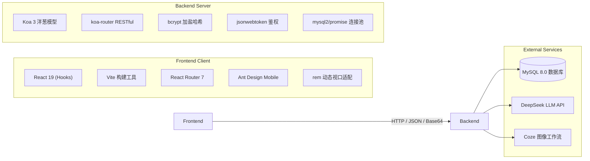

# 📘 全栈项目从 0 到 1 完整实战开发手册 (DEVELOPMENT_GUIDE.md)

> 本文档详细记录了本项目从零开始搭建的每一步操作、每个依赖的选型原因、核心架构设计以及每一段关键代码背后的技术原理。  
> 无论是用于毕业设计答辩、个人复习回顾，还是指导团队伙伴二次开发，本手册都是最权威详尽的参考指南。

---

## 目录导航

- [一、 宏观架构设计与技术选型](#一-宏观架构设计与技术选型)
- [二、 数据库初始化 (MySQL 8.0)](#二-数据库初始化-mysql-80)
- [三、 后端服务端从 0 到 1 构建实战 (Node.js + Koa)](#三-后端服务端从-0-到-1-构建实战-nodejs--koa)
  - [3.1 初始化后端工程与依赖安装](#31-初始化后端工程与依赖安装)
  - [3.2 依赖库选型与作用解析](#32-依赖库选型与作用解析)
  - [3.3 数据库连接池配置 (`config/db.js`)](#33-数据库连接池配置-configdbjs)
  - [3.4 防刷图形验证码模块 (`utils/captcha.js`)](#34-防刷图形验证码模块-utilscaptchajs)
  - [3.5 JWT 身份鉴权中间件 (`utils/jwt.js`)](#35-jwt-身份鉴权中间件-utilsjwtjs)
  - [3.6 数据访问层模型 (`models/userModel.js`)](#36-数据访问层模型-modelsusermodeljs)
  - [3.7 用户认证控制器 (`controllers/authController.js`)](#37-用户认证控制器-controllersauthcontrollerjs)
  - [3.8 DeepSeek 大模型对话接口 (`controllers/deepseekController.js`)](#38-deepseek-大模型对话接口-controllersdeepseekcontrollerjs)
  - [3.9 Coze 多模态图像识别接口 (`controllers/cozeController.js`)](#39-coze-多模态图像识别接口-controllerscozecontrollerjs)
  - [3.10 路由分发与服务主入口 (`src/index.js`)](#310-路由分发与服务主入口-srcindexjs)
- [四、 前端移动端从 0 到 1 构建实战 (React 19 + Vite)](#四-前端移动端从-0-到-1-构建实战-react-19--vite)
  - [4.1 Vite 脚手架初始化与依赖安装](#41-vite-脚手架初始化与依赖安装)
  - [4.2 移动端动态 rem 视口自适应方案 (`utils/rem.js`)](#42-移动端动态-rem-视口自适应方案-utilsremjs)
  - [4.3 Axios 网络请求封装与拦截器设计 (`http/index.js`)](#43-axios-网络请求封装与拦截器设计-httpindexjs)
  - [4.4 移动端单页路由架构 (`App.jsx`)](#44-移动端单页路由架构-appjsx)
  - [4.5 底部导航容器组件 (`pages/Layout.jsx`)](#45-底部导航容器组件-pageslayoutjsx)
  - [4.6 认证页面滑动切换动画 (`App.jsx` & `app.less`)](#46-认证页面滑动切换动画-appjsx--appless)
  - [4.7 硬件级摄像头调用与 Canvas 图片采集 (`imageCaptureAndProcess/index.jsx`)](#47-硬件级摄像头调用与-canvas-图片采集-imagecaptureandprocessindexjsx)
  - [4.8 智能对话交互界面设计 (`pages/AiChat.jsx`)](#48-智能对话交互界面设计-pagesaichatjsx)
- [五、 全栈联调与高频踩坑避雷指南](#五-全栈联调与高频踩坑避雷指南)

---

## 一、 宏观架构设计与技术选型

本项目为标准的**前后端分离架构（B/S）**，专为移动端视口设计，并结合大模型与多模态 AI 能力：



* **前端选型 React 19 + Vite**：启动和热更新秒级响应；采用函数式组件与 Hooks，搭配轻量美观的 Ant Design Mobile。
* **后端选型 Node.js + Koa 3**：Koa 相比 Express 更为轻量，天生支持 async/await 异步洋葱模型，中间件机制优雅纯粹。
* **数据持久化选型 MySQL 8.0 + mysql2/promise**：关系型数据库，利用 Promise 连接池实现高并发与非阻塞 I/O。
* **双 AI 引擎**：
  * **文本交互**：接入 DeepSeek 大模型（OpenAI SDK 协议标准）。
  * **视觉多模态**：接入 Coze 图像理解与语音合成（TTS）工作流。

---

## 二、 数据库初始化 (MySQL 8.0)

在开发服务端前，先在本地 MySQL 建立数据库与数据表。

### 1. 创建数据库与数据表
打开数据库终端或 Navicat / DataGrip，执行以下 SQL 语句：

```sql
-- 1. 创建数据库（utf8mb4 支持 Emoji 表情与生僻字）
CREATE DATABASE IF NOT EXISTS `parent_kid_education` 
DEFAULT CHARACTER SET utf8mb4 
COLLATE utf8mb4_unicode_ci;

USE `parent_kid_education`;

-- 2. 创建用户基础数据表
CREATE TABLE IF NOT EXISTS `users` (
  `id` INT AUTO_INCREMENT PRIMARY KEY COMMENT '用户唯一自增主键ID',
  `phone` VARCHAR(20) NOT NULL UNIQUE COMMENT '手机号或登录账号（唯一索引）',
  `password_hash` VARCHAR(255) NOT NULL COMMENT 'Bcrypt 加密存储的密码哈希串',
  `nickname` VARCHAR(50) DEFAULT '新用户' COMMENT '用户昵称/雅号',
  `avatar` LONGTEXT DEFAULT NULL COMMENT '用户头像（Base64 字符串或 URL 链接）',
  `create_time` DATETIME DEFAULT CURRENT_TIMESTAMP COMMENT '用户注册创建时间'
) ENGINE=InnoDB DEFAULT CHARSET=utf8mb4 COMMENT='用户核心账号表';
```

> **设计要点**：
> 1. `avatar` 字段类型选为 `LONGTEXT`：因为前端支持拍照上传并转成 Base64 字符串，Base64 数据量较大（通常数万到数十万字符），普通的 `VARCHAR(255)` 或 `TEXT` 会溢出被截断。
> 2. `password_hash`：绝不存明文密码，预留 255 长度存储 Bcrypt 哈希结果（通常为 60 位）。

---

## 三、 后端服务端从 0 到 1 构建实战 (Node.js + Koa)

### 3.1 初始化后端工程与依赖安装

进入根目录，创建并进入 `backend` 文件夹：

```bash
mkdir backend
cd backend

# 初始化 package.json
npm init -y
```

安装运行依赖（Dependencies）：
```bash
npm install koa koa-router @koa/cors koa-bodyparser mysql2 bcrypt jsonwebtoken svg-captcha axios openai dotenv
```

安装开发调试依赖（DevDependencies）：
```bash
npm install nodemon -D
```

在 `backend/package.json` 的 `scripts` 中配置启动脚本：
```json
"scripts": {
  "dev": "npx nodemon src/index.js"
}
```

---

### 3.2 依赖库选型与作用解析

| 依赖库名称 | 版本要求 | 选型原因与在项目中的具体作用 |
| :--- | :--- | :--- |
| **`koa`** | `^3.1.1` | 核心 Web 框架，洋葱模型中间件机制，处理 HTTP 请求与响应。 |
| **`koa-router`** | `^14.0.0` | 路由中间件，将不同的 URL 请求（如 `/api/auth/login`）分发给不同的控制器函数。 |
| **`@koa/cors`** | `^5.0.0` | 解决前后端跨域资源共享问题（前端在 5173，后端在 3000，必须开启 CORS）。 |
| **`koa-bodyparser`**| `^4.4.1` | 解析 POST 请求体（JSON、Form 数据）。特别配置了 `jsonLimit: '30mb'` 解决大图上传报错问题。 |
| **`mysql2`** | `^3.16.0` | MySQL 驱动库，使用其 `mysql2/promise` 模块支持原生 `async/await` 查询，并提供连接池支持。 |
| **`bcrypt`** | `^6.0.0` | 业界标准的单向加盐哈希库。采用 SaltRounds=10 进行密码散列，从根本上杜绝彩虹表破解和拖库明文风险。 |
| **`jsonwebtoken`** | `^9.0.3` | 生成与校验 JWT Token。在客户端实现无状态（Stateless）身份认证，减轻服务端 Session 存储压力。 |
| **`svg-captcha`** | `^1.4.0` | 纯 Node.js 生成带干扰线的 SVG 图形验证码，无需 C++ 底层图形库依赖，部署极度稳定。 |
| **`axios`** | `^1.13.2` | 后端作为客户端，向 Coze 工作流接口发起 HTTP 请求传输图片数据。 |
| **`openai`** | `^6.16.0` | 官方 OpenAI SDK，配置 DeepSeek 的 `baseURL` 即可无缝接入 DeepSeek 大模型对话。 |
| **`dotenv`** | `^17.2.3` | 读取 `.env` 和 `.env.local` 环境变量文件，实现敏感 API Key 和数据库密码与代码解耦。 |
| **`nodemon`** | 开发依赖 | 监听后端代码改动，代码保存后自动重启服务，极大提升开发效率。 |

---

### 3.3 数据库连接池配置 (`config/db.js`)

文件路径：`backend/src/config/db.js`

```javascript
const mysql = require('mysql2/promise')

// 创建 MySQL 连接池
const pool = mysql.createPool({
  host: process.env.DB_HOST || 'localhost',
  user: process.env.DB_USER || 'root',
  password: process.env.DB_PASSWORD || '123456',
  database: process.env.DB_NAME || 'parent_kid_education',
  port: process.env.DB_PORT || 3306,
  waitForConnections: true, // 连接满时排队等待，而不是直接报错
  connectionLimit: 10,      // 连接池最大连接数：10
  queueLimit: 0             // 排队队列无上限
})

module.exports = pool
```

> **为什么必须用连接池（Connection Pool）？**  
> 如果每次执行 SQL 都临时 `createConnection()`，高并发下 TCP 三次握手和身份验证会导致性能暴跌甚至耗尽端口。连接池预先维护若干活动长连接，复用连接，性能提升数倍。

---

### 3.4 防刷图形验证码模块 (`utils/captcha.js`)

文件路径：`backend/src/utils/captcha.js`

```javascript
const svgCaptcha = require('svg-captcha')

// 使用内存 Map 存储验证码及其过期时间
const captchaStore = new Map()
const CAPTCHA_EXPIRE_TIME = 5 * 60 * 1000 // 5 分钟有效期

// 生成验证码
function generateCaptcha() {
  const captcha = svgCaptcha.create({
    size: 4,               // 4 位字符
    ignoreChars: '0o1il',  // 排除容易混淆的字符（0与o，1与i与l）
    noise: 2,              // 2 条干扰线条
    color: true,           // 彩色文字
    background: '#f0f0f0'  // 浅灰背景
  })

  // 生成唯一 ID（时间戳 + 随机串）
  const captchaId = `captcha_${Date.now()}_${Math.random().toString(36).substring(2, 9)}`

  captchaStore.set(captchaId, {
    text: captcha.text.toLowerCase(), // 转小写存入，比对时不区分大小写
    expireAt: Date.now() + CAPTCHA_EXPIRE_TIME
  })

  return { id: captchaId, svg: captcha.data }
}

// 校验验证码
function verifyCaptcha(captchaId, code) {
  if (!captchaStore.has(captchaId)) {
    return { valid: false, message: '验证码已失效，请重新获取' }
  }

  const stored = captchaStore.get(captchaId)
  
  // 检查是否过期
  if (Date.now() > stored.expireAt) {
    captchaStore.delete(captchaId)
    return { valid: false, message: '验证码已过期，请重新获取' }
  }

  // 比对验证码（比对完立即删除，防止暴力穷举爆破）
  const isValid = stored.text === code.toLowerCase()
  captchaStore.delete(captchaId)

  return isValid ? { valid: true } : { valid: false, message: '验证码错误' }
}

module.exports = { generateCaptcha, verifyCaptcha }
```

---

### 3.5 JWT 身份鉴权中间件 (`utils/jwt.js`)

文件路径：`backend/src/utils/jwt.js`

```javascript
const jwt = require('jsonwebtoken')
const JWT_SECRET = '666' // 签名密钥

function verifyToken() {
  return async (ctx, next) => {
    // 从请求头获取 token: Authorization
    const token = ctx.request.header.authorization

    if (!token) {
      ctx.status = 416 // 自定义未授权状态码
      ctx.body = { message: 'token 不存在，请先登录', code: 0 }
      return
    }

    try {
      // 验证并解码 Token
      const decoded = jwt.verify(token, JWT_SECRET)
      if (decoded.id) {
        // 将解密出的 userId 挂载到 ctx 上下文，供后续业务控制器直接使用
        ctx.userId = decoded.id
        await next() // 放行进入下一个中间件
      }
    } catch (error) {
      ctx.status = 416
      ctx.body = { message: 'token 过期或无效，请重新登录', code: 0 }
    }
  }
}

module.exports = { verifyToken }
```

---

### 3.6 数据访问层模型 (`models/userModel.js`)

文件路径：`backend/src/models/userModel.js`

采用 MVC 分层思想，Controller 不直接拼接 SQL，统一委托给 Model：

```javascript
const db = require('../config/db.js')

// 1. 通过手机号查用户（登录/查重）
async function findUserByPhone(phone) {
  const [rows] = await db.execute('SELECT * FROM users WHERE phone = ? LIMIT 1', [phone])
  return rows[0]
}

// 2. 新增用户（注册）
async function createUser({ phone, passwordHash, nickname }) {
  const [res] = await db.execute(
    'INSERT INTO users (phone, password_hash, create_time, nickname) VALUES (?, ?, NOW(), ?)', 
    [phone, passwordHash, nickname]
  )
  if (res.affectedRows) {
    return { id: res.insertId, phone }
  }
}

// 3. 通过 ID 查用户（获取个人信息）
async function findUserById(id) {
  const [rows] = await db.execute('SELECT * FROM users WHERE id = ? LIMIT 1', [id])
  return rows[0]
}

// 4. 动态更新用户信息（修改昵称、头像、密码）
async function updateUserInfo(params, id) {
  const allowedKeys = ['avatar', 'nickname', 'password_hash']
  const keys = Object.keys(params).filter(k => allowedKeys.includes(k))

  if (keys.length === 0) throw new Error('无有效修改参数')

  const setClause = keys.map(k => `${k} = ?`).join(', ')
  const values = [...keys.map(k => params[k]), id]

  const [res] = await db.execute(`UPDATE users SET ${setClause} WHERE id = ?`, values)
  return res
}

module.exports = { findUserByPhone, createUser, findUserById, updateUserInfo }
```

---

### 3.7 用户认证控制器 (`controllers/authController.js`)

文件路径：`backend/src/controllers/authController.js`

负责核心登录注册流程控制：
* **注册**：校验验证码 ➔ 查重手机号 ➔ `bcrypt.hash(password, 10)` 密码加密 ➔ 入库。
* **登录**：查手机号 ➔ `bcrypt.compare(password, hash)` 校验密码 ➔ `jwt.sign({ id, phone }, '666', { expiresIn: '7d' })` 签发 7 天有效 Token。

---

### 3.8 DeepSeek 大模型对话接口 (`controllers/deepseekController.js`)

文件路径：`backend/src/controllers/deepseekController.js`

```javascript
const OpenAI = require('openai')

const openai = new OpenAI({
  baseURL: 'https://api.deepseek.com',
  apiKey: process.env.VITE_DEEPSEEK_API_KEY
})

async function deepseekChat(ctx) {
  const { message } = ctx.request.body
  if (!message) {
    ctx.status = 400
    ctx.body = { message: '消息不能为空', code: 0 }
    return
  }

  try {
    const completion = await openai.chat.completions.create({
      messages: [
        { role: "system", content: "你是一个专业的知识助手" },
        { role: "user", content: message }
      ],
      model: "deepseek-chat"
    })

    ctx.body = {
      code: 1,
      message: completion.choices[0].message.content
    }
  } catch (error) {
    ctx.status = 500
    ctx.body = { code: 0, message: '大模型调用异常', error: error.message }
  }
}

module.exports = { deepseekChat }
```

---

### 3.9 Coze 多模态图像识别接口 (`controllers/cozeController.js`)

文件路径：`backend/src/controllers/cozeController.js`

```javascript
const axios = require('axios')

async function recognition(ctx) {
  const { img } = ctx.request.body // 接收前端发来的 Base64 字符串
  const apiKey = process.env.VITE_COZE_IMAGE_TO_TEXT_AND_VOICE || ''

  try {
    // 转发请求至字节 Coze 工作流
    const res = await axios({
      method: 'post',
      url: 'https://r85vf8qf77.coze.site/run',
      headers: {
        'Authorization': `Bearer ${apiKey}`,
        'Content-Type': 'application/json'
      },
      data: { image: img }
    })

    ctx.body = { code: 1, data: res.data }
  } catch (error) {
    ctx.status = 500
    ctx.body = { code: 0, message: error.message }
  }
}

module.exports = { recognition }
```

---

### 3.10 路由分发与服务主入口 (`src/index.js`)

文件路径：`backend/src/index.js`

```javascript
const Koa = require('koa')
const Router = require('koa-router')
const cors = require('@koa/cors')
const bodyParser = require('koa-bodyparser')
const dotenv = require('dotenv')

// 1. 优先加载本地环境变量
dotenv.config({ path: ['.env.local', '.env'] })

// 2. 引入各个路由模块
const authRoutes = require('./routes/authRoutes.js')
const cozeRoutes = require('./routes/coze-api.js')
const deepseekRoutes = require('./routes/deepseek-api.js')

const app = new Koa()

// 3. 核心中间件链
app.use(cors()) // 支持跨域
app.use(bodyParser({ jsonLimit: '30mb' })) // 核心：支持解析 30MB 超大图片 Base64

// 4. 测试与健康检查接口
const router = new Router({ prefix: '/api' })
router.get('/test', (ctx) => {
  ctx.body = { status: 'ok', message: 'Koa 服务运行正常' }
})

// 5. 挂载子路由
app.use(router.routes()).use(router.allowedMethods())
app.use(authRoutes.routes()).use(authRoutes.allowedMethods())
app.use(cozeRoutes.routes()).use(cozeRoutes.allowedMethods())
app.use(deepseekRoutes.routes()).use(deepseekRoutes.allowedMethods())

// 6. 监听 3000 端口
app.listen(3000, () => {
  console.log('后端服务成功运行在 http://localhost:3000')
})
```

---

## 四、 前端移动端从 0 到 1 构建实战 (React 19 + Vite)

### 4.1 Vite 脚手架初始化与依赖安装

在根目录下创建并初始化前端应用：

```bash
# 1. 使用 Vite 官方模板创建 React 工程
npm create vite@latest frontend -- --template react

# 2. 进入前端目录
cd frontend

# 3. 安装依赖
npm install
```

安装项目业务依赖：
```bash
# 生产依赖：移动端UI库、路由、网络请求
npm install antd-mobile react-router-dom axios

# 开发依赖：Less 样式预处理器
npm install less -D
```

---

### 4.2 移动端动态 rem 视口自适应方案 (`utils/rem.js`)

文件路径：`frontend/src/utils/rem.js`

为了让页面在不同的移动端设备（如 iPhone SE、iPhone 15 Pro Max、iPad）上均保持严格等比缩放，采用 **屏幕宽度 10 等分自适应算法**：

```javascript
(function(win, doc) {
  const docEl = doc.documentElement

  function refreshRem() {
    const width = docEl.clientWidth
    // 核心公式：将视口宽度分为 10 份，设置根节点 html 的 font-size
    // 例如屏幕宽 375px 时，1rem = 37.5px；屏幕宽 390px 时，1rem = 39px
    docEl.style.fontSize = width / 10 + 'px'
  }

  refreshRem()
  // 监听屏幕旋转与窗口尺寸改变，自动重算
  win.addEventListener('resize', refreshRem)
  win.addEventListener('pageshow', (e) => {
    if (e.persisted) refreshRem() // 从缓存恢复页面时重算
  })

  // 恢复 body 默认字号为 16px，防止继承 html 的大字号
  doc.body.style.fontSize = '16px'
})(window, document)
```

在 [`frontend/src/main.jsx`](file:///D:/SinoWind/sino-wind/frontend/src/main.jsx) 顶部第一行直接引入该文件：
```javascript
import './utils/rem.js' // 保证优先执行
import './styles/global.css'
```

---

### 4.3 Axios 网络请求封装与拦截器设计 (`http/index.js`)

文件路径：`frontend/src/http/index.js`

```javascript
import axios from 'axios'
import { Toast } from 'antd-mobile'

axios.timeout = 15000 // 15 秒超时（AI 思考与图像生成需要一定响应时间）

// 本地联调自动走 localhost，部署线上自动走线上域名/IP
const isLocal = typeof window !== 'undefined' && 
  (window.location.hostname === 'localhost' || window.location.hostname === '127.0.0.1')
axios.defaults.baseURL = import.meta.env.VITE_API_BASE_URL || (isLocal ? 'http://localhost:3000' : 'http://120.26.186.48:3000')
axios.defaults.headers.post['Content-Type'] = 'application/json'

// 1. 请求拦截器：自动注入 Token
axios.interceptors.request.use(config => {
  const token = localStorage.getItem('token')
  if (token) {
    config.headers.Authorization = token
  }
  return config
})

// 2. 响应拦截器：全局错误提示与鉴权拦截
axios.interceptors.response.use(
  (response) => {
    // 业务错误（HTTP 200，但后端自定义 code !== 1）
    if (response.data.code !== 1) {
      Toast.show({
        icon: 'fail',
        content: response.data.message || '请求失败'
      })
      return Promise.reject(response)
    }
    return response // 业务成功
  },
  (error) => {
    // 程序性/网络错误
    const msg = error.response?.data?.message || '网络连接异常'
    Toast.show({ icon: 'fail', content: msg })

    // 416 表示 Token 失效，自动清空并跳转回登录
    if (error.response?.status === 416) {
      localStorage.removeItem('token')
      setTimeout(() => {
        window.location.href = '/login'
      }, 1500)
    }

    return Promise.reject(error)
  }
)

export default axios
```

---

### 4.4 移动端单页路由架构 (`App.jsx`)

文件路径：`frontend/src/App.jsx`

采用嵌套路由结构（Nested Routes）：
* **外层卡片**：`/login`（登录与注册）。
* **主界面框架**：`/`（`Layout` 布局容器，底栏常驻），通过 `<Outlet />` 展示子路由：
  * `/home`（首页）
  * `/recognition`（拍照识别）
  * `/mine`（个人中心）
* **独立全屏页**：`/ai-chat`（对话界面，键盘弹出体验更佳）。

---

### 4.5 底部导航容器组件 (`pages/Layout.jsx`)

文件路径：`frontend/src/pages/Layout.jsx`

利用 `useNavigate` 与 `useLocation`，实现点击 Tab 切换页面并高亮：
```jsx
export default function Layout() {
  const navigate = useNavigate()
  const location = useLocation()

  return (
    <div className='layout'>
      <div className="layout-page">
        <Outlet /> {/* 二级路由页面渲染在此处 */}
      </div>
      <div className="bottom-nav">
        {tabs.map((tab) => (
          <div
            key={tab.id}
            className={`bottom-nav__item ${tab.isHightLighted ? 'hightLighted' : ''} ${location.pathname === tab.path ? 'active' : ''}`}
            onClick={() => navigate(tab.path)}
          >
            <i className={`iconfont ${tab.icon}`}></i>
            <span>{tab.name}</span>
          </div>
        ))}
      </div>
    </div>
  )
}
```

---

### 4.6 认证页面滑动切换动画 (`App.jsx` & `app.less`)

在登录/注册卡片中，没有生硬地切换两个页面，而是采用 **CSS 平滑滑动指示条**：

```jsx
<div className="slider-container">
  {/* 滑块背景色块：通过 class 切换 translateX */}
  <div className={`slider-button ${activeTab === 'register' ? 'slider-button--right' : ''}`}></div>
  <div className="slider-tabs">
    <button onClick={() => setActiveTab('login')}>登录</button>
    <button onClick={() => setActiveTab('register')}>注册</button>
  </div>
</div>
```

对应 Less 动画：
```less
.slider-button {
  position: absolute;
  width: calc(50% - 3px);
  transition: transform 0.3s cubic-bezier(0.4, 0, 0.2, 1);
  &--right {
    transform: translateX(100%); // 向右滑动
  }
}
```

---

### 4.7 硬件级摄像头调用与 Canvas 图片采集 (`imageCaptureAndProcess/index.jsx`)

文件路径：`frontend/src/components/imageCaptureAndProcess/index.jsx`

前端调用硬件拍照并转 Base64 的完整代码闭环：

```javascript
// 1. 调用系统摄像头
const stream = await navigator.mediaDevices.getUserMedia({ video: true })
videoRef.current.srcObject = stream
videoRef.current.play()

// 2. 截取一帧画面绘制到 Canvas
setTimeout(() => {
  const canvas = canvasRef.current
  canvas.width = videoRef.current.videoWidth
  canvas.height = videoRef.current.videoHeight
  const ctx = canvas.getContext('2d')
  ctx.drawImage(videoRef.current, 0, 0, canvas.width, canvas.height)

  // 3. 及时关闭摄像头硬件流释放资源
  stream.getTracks().forEach(track => track.stop())

  // 4. 将 Canvas 转为 Blob 并进一步通过 FileReader 转为 Base64 发给后端
  canvas.toBlob((blob) => {
    const reader = new FileReader()
    reader.readAsDataURL(blob)
    reader.onload = () => {
      const base64String = reader.result // 发送给后端的图片数据
      onRecognition(base64String)
    }
  }, 'image/jpeg', 0.8) // 0.8 压缩比，兼顾清晰度与传输速度
}, 1000)
```

---

### 4.8 智能对话交互界面设计 (`pages/AiChat.jsx`)

文件路径：`frontend/src/pages/AiChat.jsx`

* **消息状态流**：维护 `messages` 数组（存储 `{ id, role: 'user'|'ai', content, timestamp }`）。
* **自动滚动触底**：通过 `messagesEndRef.current?.scrollIntoView({ behavior: 'smooth' })`，新消息到达时自动平滑滚动到最新一条。
* **回车发送**：监听 `onKeyDown`，按下 `Enter` 且未按 `Shift` 时立即发送。

---

## 五、 全栈联调与高频踩坑避雷指南

1. **前后端联调网络报错：`Connection reset` 或 `Failed to fetch`**
   * **排查点**：检查 `frontend/src/http/index.js` 中的 `baseURL` 是否为 `http://localhost:3000`。
   * **排查点**：检查后端 `app.use(cors())` 跨域中间件是否挂载在路由之前。

2. **拍照上传提示 413 Payload Too Large（请求体过大）**
   * **原因**：Koa 的 `bodyParser` 默认仅允许 1MB JSON 数据，照片 Base64 普遍有 2MB~8MB。
   * **解决**：在 `backend/src/index.js` 中必须显式配置：`bodyParser({ jsonLimit: '30mb' })`。

3. **MySQL 连接报错 `ECONNREFUSED` 或 `Access denied`**
   * **排查点**：本地 MySQL 服务是否启动。
   * **排查点**：核对 `backend/src/config/db.js` 或 `.env.local` 中的密码是否是当前机器 root 的密码。

4. **Windows Git 提交报 `Could not create directory .../.ssh`**
   * **原因**：Windows 中文用户名编码冲突。
   * **解决**：在终端执行 `git config --global core.sshCommand "C:/Windows/System32/OpenSSH/ssh.exe"`。
