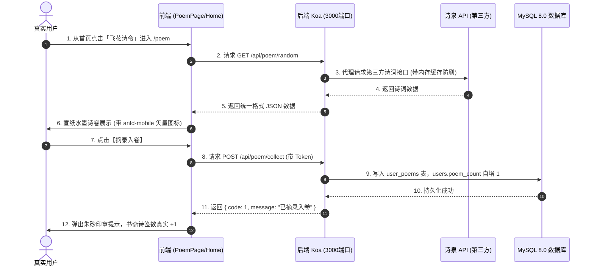

# 🎯《云山竹简 · 华风雅集》Day 1 全栈极速冲刺技术需求文档 (TRD - Day 1)

| 文档版本 | 状态 | 编写人 | 执行周期 | 核心目标 |
| :--- | :--- | :--- | :--- | :--- |
| **v1.1 (Day 1 专属执行版)** | **已生效 (Approved)** | 队长兼成员 C (全栈架构把关) | **首日 24 小时** (10-12) | **全栈链路真实打通 · 诗词天地首度落地 · 第一阶段遗留缺陷必修清零** |

---

## 📢 队长令（兼成员 C 身份声明）

> **致全体组员（成员 A、成员 B）**：  
> 我是成员 C，同时兼任团队队长。  
> 经第一阶段全量代码评审，我们在 UI 还原与多端自适应上取得了巨大突破，但在细节处仍存在不少**“旧项目遗留代码残留”、“生硬死图片图标”、“原生文本符号充当图标”**等工程缺陷。  
> **第二阶段绝不带着第一阶段的毛病往前走！**  
> 队长已在主干安装好 `antd-mobile-icons`，并已在【观藏】与【书斋】中做好了标杆示范（所有原生 `>` 字符已全部替换为规范的 `<RightOutline />`，Axios 已统一走拦截器）。  
> **今日 Day 1，成员 A 和成员 B 必须在开工新功能的同时，将各自负责模块的第一阶段遗留缺陷全部清零改掉！**

---

## 🚫 一、 队长第一硬指标：图标体系全量换用 `antd-mobile-icons`

> ⚠️ **所有人在编写或修改 UI 时，严禁截取或硬塞任何死图片图标（png/jpg）！严禁手写 SVG 拼图标！严禁写原生 `>` 字符！**  
> 所有人必须按以下方式引入官方矢量图标库：

```jsx
// 必须且只能从官方库引用图标：
import { 
  RightOutline,        // 严禁用 >，所有列表与按钮右箭头统一使用
  LeftOutline,         // 所有页面顶部返回箭头统一使用（严禁使用第三方不齐的字体图标）
  DownOutline,         // 展开/下拉箭头（替换 Home 里的字符 ⌄）
  SearchOutline,       // 搜索框图标
  RedoOutline,         // 重研墨宝（换一首）按钮图标
  HeartOutline,        // 摘录入卷（收藏）按钮图标
  BookOutline,         // 诗意赏析折叠面板图标
  EyeOutline,          // 密码可见（替换手写 SVG）
  EyeInvisibleOutline, // 密码隐藏（替换手写 SVG）
  LockOutline,         // 安全与密押锁图标
  SoundOutline,        // 朗诵与语音图标
  CameraOutline,       // 相机拍照图标
  PictureOutline       // 相册上传图标
} from 'antd-mobile-icons'
```

* **统一着色准则**：在对应 Less 中通过 `color: @color-seal;`（朱砂红 `#9E2A2B`）或 `@color-gold` 统一着色，尺寸 `16px ~ 20px`。

---

## 🛠️ 二、 第一阶段遗留缺陷必修清单（今日必须改掉）

---

### 🚨 【成员 A 必改项】（登录注册与后端遗留）
1. **清理手写 SVG 拼装图标**：
   - 文件：`frontend/src/pages/Login.jsx` 与 `Register.jsx`；
   - 问题：目前密码眼睛、通行密押锁、账号使用了自己手写的 `AuthIcon` SVG 字符串；
   - 改法：彻底废弃手写 Path，换用 `import { EyeOutline, EyeInvisibleOutline, LockOutline } from 'antd-mobile-icons'`。
2. **清理后端旧项目残留 Prompt**：
   - 文件：`backend/src/controllers/deepseekController.js`；
   - 问题：目前代码第 25 行硬编码了 `role: "system", content: "你是一个专业的教育助手"`（旧儿童项目遗留）；
   - 改法：改为根据前端传来的 `sageId`（`libai`, `sushi`, `wangyangming`, `liqingzhao`）动态切换四大文宗人设（豪放诗仙、旷达东坡、心学宗师、婉约词宗）。
3. **补充账号设置接口异常兜底**：
   - 文件：`frontend/src/pages/AccountSetting.jsx`；
   - 问题：第 30 行 `axios.get('/api/auth/info')` 缺少 `.catch()` 处理，未登录或断网时会导致白屏卡死；
   - 改法：增加 `.catch()` 并在头像、昵称处增加优雅的古典默认值兜底。顶部返回按钮 `<i className='iconfont icon-fanhui'>` 替换为 `<LeftOutline />`。

---

### 🚨 【成员 B 必改项】（首页与识宝组件遗留）
1. **清理首页文本符号充当图标**：
   - 文件：`frontend/src/pages/Home.jsx`；
   - 问题：第 69 行城市天气旁使用了原生字符 `<span className="home-almanac__caret">⌄</span>`；
   - 改法：替换为 `<DownOutline className="home-almanac__caret" />`。
2. **纠正路由断层与跳转逻辑**：
   - 文件：`frontend/src/pages/Home.jsx`；
   - 问题：四大雅席中的“飞花诗令”之前跳了 `/ai`（导致与观藏重合），“四般闲事”之前跳了 `/mine`（体验割裂）；
   - 改法：将“飞花诗令”的 `path` 纠正为 `/poem`（直通全新古诗词天地）；“四般闲事”若无独立页面，暂时给出优雅的古风 Toast 提示，切勿直接跳个人中心。
3. **彻底清除 AI 识物组件的儿童卡通遗留**：
   - 文件：`frontend/src/components/imageCaptureAndProcess/index.jsx` 与 `index.less`；
   - 问题：第 22 行写死了 `primary: '#ff7a45'`（高饱和橙色）以及儿童向渐变背景；顶部标题写着“AI 拍照识物”；返回按钮、拍照图标均混杂了未对齐的 class；
   - 改法：
     - 主题色全面改回国风朱砂红（`#9E2A2B`）；
     - 标题改为文人雅致的「博古识器 · 拍照品鉴」；
     - 返回按钮替换为 `<LeftOutline />`，清除按钮替换为 `<CloseOutline />`，拍照替换为 `<CameraOutline />`，相册上传替换为 `<PictureOutline />`。
4. **清除识别结果组件中的儿童安全提示残留**：
   - 文件：`frontend/src/components/recognitionResult/Index.jsx`；
   - 问题：目前组件里赫然写着“物品介绍”、“安全提示”，带有浓厚的少儿玩具识别痕迹；
   - 改法：
     - 标题改为「金石鉴赏」；
     - 描述字段改为「器物考释」与「文人品鉴心得」；
     - 音量朗诵图标替换为 `<SoundOutline />`。
5. **规范智能对话页面的水墨风格与返回图标**：
   - 文件：`frontend/src/pages/AiChat.jsx`；
   - 问题：欢迎语是生硬的“你好，我是智能对话助手”以及机器人图标；返回按钮是未对齐的字体；
   - 改法：
     - 返回按钮替换为 `<LeftOutline />`；
     - 读取 `location.state.sageId`，标题动态显示为对应先贤名字（如“千古知己 · 李白”）；
     - 欢迎语改为对应先贤的诗文致意（如李白：“举杯邀明月，对影成三人。知己至此，何不畅叙幽情？”）。

---

## 🚀 三、 Day 1 全新业务功能开发（与缺陷修改并行）



### 1. 【成员 A】新增数据表与诗词代理接口
* **分支**：`feat/phase2-backend`
* **建表脚本**（在 MySQL 中执行）：
```sql
ALTER TABLE users 
ADD COLUMN IF NOT EXISTS appraise_count INT DEFAULT 12 COMMENT '鉴宝藏器数',
ADD COLUMN IF NOT EXISTS debate_count INT DEFAULT 36 COMMENT '论道问策数',
ADD COLUMN IF NOT EXISTS poem_count INT DEFAULT 48 COMMENT '诗签摘录数',
ADD COLUMN IF NOT EXISTS rank_level VARCHAR(20) DEFAULT '玖阶' COMMENT '文风品位品阶';

CREATE TABLE IF NOT EXISTS user_poems (
  id INT AUTO_INCREMENT PRIMARY KEY,
  user_id INT NOT NULL COMMENT '用户ID',
  poem_id VARCHAR(64) COMMENT '诗词ID',
  title VARCHAR(100) NOT NULL COMMENT '诗词标题',
  author VARCHAR(50) NOT NULL COMMENT '作者',
  dynasty VARCHAR(30) DEFAULT '唐代' COMMENT '朝代',
  content TEXT NOT NULL COMMENT '诗词正文',
  appreciation TEXT COMMENT '赏析',
  created_at TIMESTAMP DEFAULT CURRENT_TIMESTAMP,
  INDEX idx_user_id (user_id)
) ENGINE=InnoDB DEFAULT CHARSET=utf8mb4 COMMENT='用户诗签收藏表';
```
* **接口实现**：
  - 新建 `backend/src/controllers/poemController.js`（代理诗泉 API，带本地 Mock 降级防限频）；
  - 新建 `backend/src/routes/poemRoutes.js`，在 `backend/src/index.js` 挂载；
  - 严格遵守 [`docs/PHASE2_API_CONTRACT.md`](./PHASE2_API_CONTRACT.md) 的 JSON 规范。

### 2. 【成员 B】新建古诗词天地页面
* **分支**：`feat/phase2-frontend-poem`
* **组件实现**：
  - 新建 `frontend/src/pages/PoemPage.jsx` 与 `frontend/src/styles/poem.less`；
  - 在 `frontend/src/App.jsx` 注册路由 `<Route path='/poem' element={<PoemPage/>}></Route>`；
  - 严格使用 `antd-mobile-icons`：
    - 换一首：`<RedoOutline />`
    - 摘录入卷：`<HeartOutline />`
    - 诗境赏析：`<BookOutline />`
    - 搜索图标：`<SearchOutline />`
  - 接入宣纸卷轴样式，点击“摘录入卷”调取 `POST /api/poem/collect` 接口并弹出 Toast 反馈。

### 3. 【成员 C / 队长】书斋数据联动与总装合流
* **分支**：`feat/phase2-integrate`
* **职责**：
  - 书斋 `MinePage.jsx` 联动真实修持数据；
  - 搭建书斋二级页“我的诗笺”骨架；
  - 审查成员 A 和成员 B 的 PR，严格核查是否仍有生硬死图片图标；
  - 执行 `npm run build`，确保首日代码合流 0 错误。

---

## 📋 四、 Day 1 验收打勾清单 (Checklist)

* [ ] 成员 A：MySQL 执行 SQL 成功，`users` 表包含修持四维字段，`user_poems` 表已建立。
* [ ] 成员 A：`Login.jsx` 和 `Register.jsx` 已全面使用 `antd-mobile-icons`，手写 SVG 已清理完毕。
* [ ] 成员 A：`deepseekController.js` 已彻底移除旧儿童项目提示词，按四大先贤动态注入 Prompt。
* [ ] 成员 B：`Home.jsx` 的 caret 符号已换为 `<DownOutline />`，“飞花诗令”已正确指向 `/poem`。
* [ ] 成员 B：`imageCaptureAndProcess` 与 `recognitionResult` 中的橙色儿童风、安全提示已全面重构为国风文博品鉴与标准矢量图标。
* [ ] 成员 B：从首页点击「飞花诗令」能顺畅进入 `/poem`，宣纸排版精美，换一首与摘录功能正常。
* [ ] 成员 C / 队长：全量代码审查通过，无违规图片图标，`npm run build` 0 报错。
