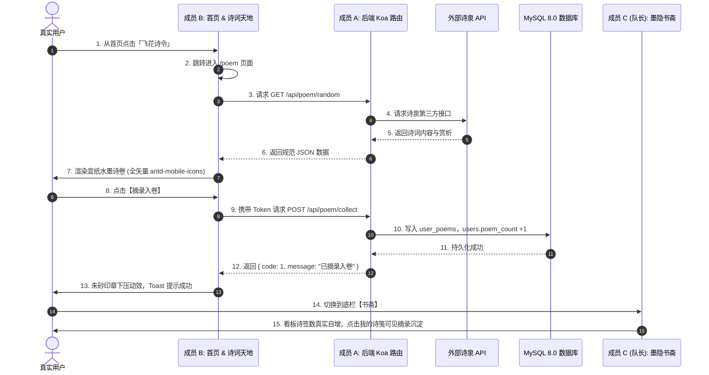

# 📜《云山竹简 · 华风雅集》Day 1 全栈冲刺技术需求与任务派发书 (TRD - Day 1)

> **文档性质**：队长（兼成员 C）第二阶段首日任务派发与技术执行标准  
> **撰写人**：队长（兼成员 C / 观藏与书斋负责人）  
> **执行周期**：Day 1 首日 24 小时 (10-12)  
> **核心战略**：**不带病冲刺 · 第一阶段遗留缺陷清零 · 全栈真实活数据打通 · 图标规范归位**

---

## 一、 队长战前发言：我的工程原则与首日目标

全体组员（成员 A、成员 B）：

我是队长，同时也是负责【观藏】与【书斋】的成员 C。

在昨晚的第一阶段（Phase 1）合流中，我们成功把项目从早期的儿童教育原型全面升级为两宋水墨国风。我作为成员 C，已经带头完成了移动端 `rem.js` 视口上下限锁定（320~540px）、PC 端 480px 居中画幅、四大先贤画廊与水墨书斋的完整开发。

但在合并验收你们提交的代码时，我发现了几个**绝不能带入第二阶段的硬伤**：
1. **图标乱象**：代码里有手写的 SVG 路径、有粗糙的文本字符 `>`、还有直接拿死图片硬塞当图标的做法。这在高清视网膜屏下极易模糊、无法用 Less 朱砂红变量动态着色，极具廉价贴纸感！
2. **旧项目残留**：后端 DeepSeek 控制器里居然还赫然写着*“你是一个专业的教育助手”*；AI 识物组件里还留着*“高饱和橙色 #ff7a45”*和针对儿童的*“安全提示”*！
3. **路由断层**：首页的“飞花诗令”直接跳到了观藏，“四般闲事”直接跳到了个人中心。

**作为队长，我的要求非常明确：第二阶段绝不带病狂奔！**  
我已经为全队在 `main` 主干统一安装了官方标准矢量图标库 `antd-mobile-icons`，并在【观藏】与【书斋】中给你们做好了标杆示范——所有的原生 `>` 已全部换成 `<RightOutline />`，所有的请求统一走 Axios 拦截器。

**今天 Day 1，你们在开工新功能的同时，必须把我给你们指出的遗留问题全部改掉！**

---

## 🚫 二、 我给大家立的图标死命令：严禁死图片，去 antd-mobile 找

> ### ⚠️ 队长红线（违者打回 PR）
> **严禁从网上截图、切图任何 png/jpg 死图片充当图标！严禁用生硬文本字符充当图标！**  
> 所有系统图标、操作按钮、状态图标，**必须且只能从 `antd-mobile-icons` 引入**。

### 我要求大家统一使用的图标速查表：
```jsx
// 全员统一从官方图标库按需引入：
import { 
  RightOutline,        // 列表右箭头、进入箭头（严禁再写 >）
  LeftOutline,         // 顶部所有返回上一页按钮（严禁使用未对齐的第三方小图标）
  DownOutline,         // 下拉/展开箭头（用于替换 Home 里的字符 ⌄）
  SearchOutline,       // 搜索框放大镜图标
  RedoOutline,         // 重研墨宝（换一首）刷新图标
  HeartOutline,        // 摘录入卷（收藏）图标
  BookOutline,         // 诗意赏析折叠面板图标
  EyeOutline,          // 密码明文显示（替换手写 SVG）
  EyeInvisibleOutline, // 密码密文隐藏（替换手写 SVG）
  LockOutline,         // 通行密押/安全锁图标
  SoundOutline,        // 语音朗读与琴音播放图标
  CameraOutline,       // 拍照鉴赏相机图标
  PictureOutline       // 相册选取上传图标
} from 'antd-mobile-icons'
```

* **着色规范**：在你们各自的 Less 中，通过 `color: @color-seal;`（朱砂红 `#9E2A2B`）或 `@color-gold` 着色，字体大小 `16px ~ 20px`，确保全站风格浑然一体。

---

## 👥 三、 我给全员拆解的 Day 1 任务派发清单

---

### 📌 【我给成员 A 的任务书】（后端接口与登录认证整改）
* **你的工作分支**：`feat/phase2-backend`
* **我要你今天完成的交付物**：

#### 1. 第一阶段缺陷整改（上午必须清零）：
* **废弃手写 SVG**：打开 `Login.jsx` 与 `Register.jsx`，把手写的 `AuthIcon` 函数和内部 SVG 路径彻底删掉，全面换用 `EyeOutline`、`EyeInvisibleOutline`、`LockOutline`。
* **重构后端 Prompt**：打开 `backend/src/controllers/deepseekController.js`，删掉*“专业的教育助手”*这种少儿旧词，改为接收前端的 `sageId`，按四大先贤注入真实性格（李白豪迈肆意、东坡旷达风趣、阳明心学知行合一、清照婉约高妙）。
* **接口健壮性补全**：打开 `AccountSetting.jsx`，为 `axios.get('/api/auth/info')` 补上 `.catch()` 异常捕获和默认降级展示；将顶部返回按钮换为 `<LeftOutline />`。

#### 2. 第二阶段核心后端接口（下午必须跑通）：
* **执行数据库初始化**：在本地 MySQL 8.0 执行以下脚本：
  ```sql
  ALTER TABLE users 
  ADD COLUMN IF NOT EXISTS appraise_count INT DEFAULT 12 COMMENT '鉴宝藏器数',
  ADD COLUMN IF NOT EXISTS debate_count INT DEFAULT 36 COMMENT '论道问策数',
  ADD COLUMN IF NOT EXISTS poem_count INT DEFAULT 48 COMMENT '诗签摘录数',
  ADD COLUMN IF NOT EXISTS rank_level VARCHAR(20) DEFAULT '玖阶' COMMENT '文风品位品阶';

  CREATE TABLE IF NOT EXISTS user_poems (
    id INT AUTO_INCREMENT PRIMARY KEY,
    user_id INT NOT NULL COMMENT '用户ID',
    poem_id VARCHAR(64) COMMENT '第三方诗词ID',
    title VARCHAR(100) NOT NULL COMMENT '诗词标题',
    author VARCHAR(50) NOT NULL COMMENT '作者',
    dynasty VARCHAR(30) DEFAULT '唐代' COMMENT '朝代',
    content TEXT NOT NULL COMMENT '诗词正文',
    appreciation TEXT COMMENT '赏析',
    created_at TIMESTAMP DEFAULT CURRENT_TIMESTAMP,
    INDEX idx_user_id (user_id)
  ) ENGINE=InnoDB DEFAULT CHARSET=utf8mb4 COMMENT='用户诗签收藏表';
  ```
* **编写诗词服务与路由**：
  - 新建 `backend/src/controllers/poemController.js`，代理诗泉古籍 API（`https://poetry.palemoky.com/`），实现随机古诗与关键词搜索；加一层内存缓存防限频，并内置 Mock 优雅降级；
  - 编写 `POST /api/poem/collect` 接口，用户收藏诗词时写入 `user_poems` 表，并自动将该用户的 `users.poem_count` 自增 1；
  - 新建 `backend/src/routes/poemRoutes.js` 并在 `backend/src/index.js` 挂载生效。

---

### 📌 【我给成员 B 的任务书】（首页联动与古诗词天地开发）
* **你的工作分支**：`feat/phase2-frontend-poem`
* **我要你今天完成的交付物**：

#### 1. 第一阶段缺陷整改（上午必须清零）：
* **替换 Home 文本字符**：打开 `Home.jsx` 第 69 行，把生硬的原生字符 `⌄` 替换为 `<DownOutline className="home-almanac__caret" />`。
* **修正首页路由逻辑**：将四大雅席里的“飞花诗令”跳转路径修改为 `/poem`；“四般闲事”暂时改成弹出古风 Toast（“焚香点茶筹备中，静候雅聚”），严禁直接跳去个人中心！
* **彻底清除 AI 识物组件中的儿童风残留**：
  - 打开 `imageCaptureAndProcess/index.jsx`，将儿童橙色 `#ff7a45` 改为国风朱砂红 `#9E2A2B`；标题改为「博古识器 · 拍照品鉴」；返回按钮换成 `<LeftOutline />`，清除按钮换成 `<CloseOutline />`，拍照与上传分别换成 `<CameraOutline />` 和 `<PictureOutline />`。
  - 打开 `recognitionResult/Index.jsx`，清除“物品介绍”、“安全提示”，改为文博专业的「金石鉴赏」、「器物考释」与「文人品鉴心得」；音量图标换用 `<SoundOutline />`。
* **规范 AiChat 智能对话**：打开 `AiChat.jsx`，返回按钮换为 `<LeftOutline />`，移除机器人图标，读取 `location.state.sageId` 动态显示先贤名号并致以古风欢迎语。

#### 2. 全新【古诗词天地】页面开发（下午完成）：
* 新建 `frontend/src/pages/PoemPage.jsx` 与 `frontend/src/styles/poem.less`；
* 在 `App.jsx` 中注册路由 `<Route path='/poem' element={<PoemPage/>}></Route>`；
* **页面四大必备要素**：
  1. 顶部搜索框：使用 `antd-mobile` 的 `SearchBar` + `<SearchOutline />`；
  2. 宣纸诗卷主体：居中展示诗名、朝代作者方印、正文对仗断句排版；
  3. 四大功能按钮（必须全量使用矢量图标）：
     - `换一首`：`<RedoOutline />`
     - `摘录入卷`：`<HeartOutline />`（点击触发朱砂印章动效，调取收藏接口）
     - `诗意赏析`：`<BookOutline />`（折叠面板展示）
     - `返回雅集`：`<LeftOutline />`

---

### 📌 【我作为成员 C / 队长今天的自我要求】
* **我的工作分支**：`feat/phase2-integrate`
* **我今天将亲自推进的核心工作**：
1. **书斋数据真实打通**：在 `MinePage.jsx` 中联调 `GET /api/auth/info`，确保四维修持看板（鉴宝、论道、诗签、阶位）实时呈现数据库真实统计；
2. **开发书斋二级页面「我的诗笺」**：新建 `PoemCollection.jsx`，点击书斋的“我的诗笺”列表项进入，瀑布流优雅展示用户已摘录的诗词墨卷；
3. **联调博古识器**：将识别成功的文物数据同步递增用户书斋中的“鉴宝藏器数”；
4. **今晚 22:00 组织合流与质量审查**：
   - 审查成员 A 和成员 B 的代码，**凡发现未经许可私用死图片图标或未清理遗留缺陷的，我一律直接打回**；
   - 执行 `npm run build` 打包构建，保证首日生产环境编译 0 报错。

---

## 🔄 四、 我要求全员跑通的 Day 1 核心业务闭环



---

## 📋 五、 今晚 22:00 我的验收打勾清单 (Checklist)

只有以下每一项全部打勾，Day 1 任务才算合格收工：

* [ ] **成员 A**：MySQL 脚本执行成功，`users` 表与 `user_poems` 表结构完备。
* [ ] **成员 A**：`Login.jsx` / `Register.jsx` 中的手写 SVG 全部被 `antd-mobile-icons` 替换。
* [ ] **成员 A**：`deepseekController.js` 彻底清除旧少儿 Prompt，支持四大先贤人设。
* [ ] **成员 B**：`Home.jsx` 的原生字符 `⌄` 已换成 `<DownOutline />`，“飞花诗令”正确指向 `/poem`。
* [ ] **成员 B**：`imageCaptureAndProcess` 与 `recognitionResult` 中的橙色少儿风与“安全提示”全部清零，换成文博品鉴与标准矢量图标。
* [ ] **成员 B**：古诗词天地页面排版精美，换一首、赏析与摘录功能全部正常，**绝对无死图片图标**。
* [ ] **成员 C (队长)**：书斋修持数据真实递增，“我的诗笺”二级页列表可见，全站 `npm run build` 0 报错。
