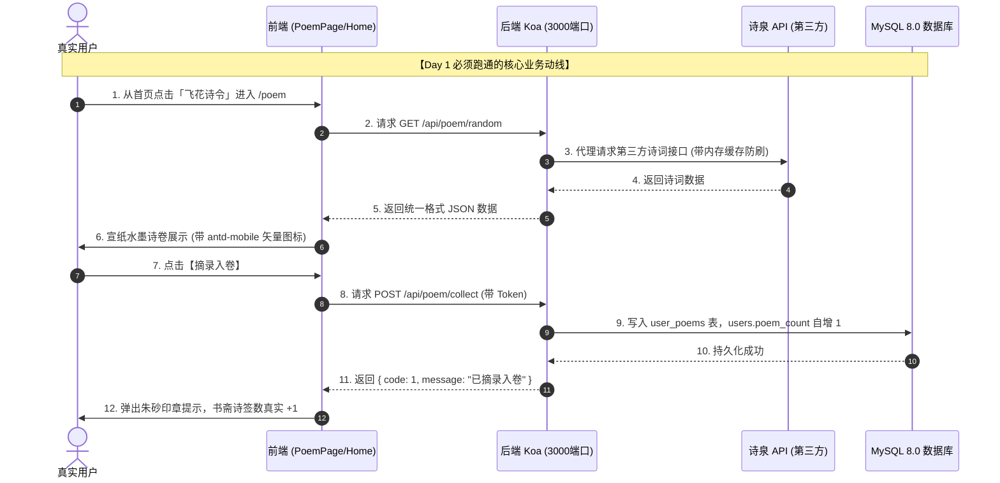

# 🎯《云山竹简 · 华风雅集》Day 1 全栈极速冲刺技术需求文档 (TRD - Day 1)

| 文档版本 | 状态 | 编写人 | 执行周期 | 核心目标 |
| :--- | :--- | :--- | :--- | :--- |
| **v1.0 (Day 1 专属执行版)** | **已生效 (Approved)** | 队长兼技术架构师 (成员 C) | **首日 24 小时** (10-12) | **全栈链路真实打通 · 诗词天地首度落地 · 图标规范归位** |

---

## 一、 Day 1 战略总览：24 小时必须跑通的核心链路

> **队长发令**：  
> Day 1 不求铺开所有支线，**必须集中火力打通一条端到端的“真实活数据链路”**。  
> 拒绝“互相干等”——全员根据本文档的**可执行代码片段与接口标准**，并行开工！



---

## 🚫 二、 队长第一硬指标：图标体系必须使用 `antd-mobile-icons`

> ⚠️ **所有人在编写 UI 时，严禁截取或硬塞任何死图片图标（png/jpg）！严禁写原生 `>` 字符！**  
> 队长已在主干安装好 `antd-mobile-icons`，**所有人必须按以下方式引入官方矢量图标**：

```jsx
// 必须且只能这样引用图标：
import { 
  RightOutline,        // 严禁用 >，所有列表与按钮右箭头统一使用
  SearchOutline,       // 搜索框图标
  RedoOutline,         // 重研墨宝（换一首）按钮图标
  HeartOutline,        // 摘录入卷（收藏）按钮图标
  BookOutline          // 诗意赏析折叠面板图标
} from 'antd-mobile-icons'
```

* **统一着色**：在 Less 中通过 `color: @color-seal;`（朱砂红）统一着色，字号 `16px`。

---

## 👥 三、 Day 1 成员精确任务拆解与可执行代码

---

### 📌 【成员 A】后端数据与接口组（工作目录：`backend/`）
* **工作分支**：`feat/phase2-backend`
* **首日交付物清单**：

#### 任务 A1：执行 MySQL 数据库建表与字段扩展脚本
在本地 MySQL 8.0 中选中 `parent_kid_education` 库，直接执行以下 SQL：
```sql
-- 1. 扩展 users 表修持四维属性
ALTER TABLE users 
ADD COLUMN IF NOT EXISTS appraise_count INT DEFAULT 12 COMMENT '鉴宝藏器数',
ADD COLUMN IF NOT EXISTS debate_count INT DEFAULT 36 COMMENT '论道问策数',
ADD COLUMN IF NOT EXISTS poem_count INT DEFAULT 48 COMMENT '诗签摘录数',
ADD COLUMN IF NOT EXISTS rank_level VARCHAR(20) DEFAULT '玖阶' COMMENT '文风品位品阶';

-- 2. 新建用户诗签收藏表
CREATE TABLE IF NOT EXISTS user_poems (
  id INT AUTO_INCREMENT PRIMARY KEY,
  user_id INT NOT NULL COMMENT '用户ID',
  poem_id VARCHAR(64) COMMENT '诗词ID',
  title VARCHAR(100) NOT NULL COMMENT '诗词标题',
  author VARCHAR(50) NOT NULL COMMENT '作者',
  dynasty VARCHAR(30) DEFAULT '唐代' COMMENT '朝代',
  content TEXT NOT NULL COMMENT '诗词正文',
  appreciation TEXT COMMENT '赏析',
  created_at TIMESTAMP DEFAULT CURRENT_TIMESTAMP,
  INDEX idx_user_id (user_id)
) ENGINE=InnoDB DEFAULT CHARSET=utf8mb4 COMMENT='用户诗签收藏表';
```

#### 任务 A2：编写诗词控制器 (`backend/src/controllers/poemController.js`)
必须包含：**随机诗词（带优雅兜底）、关键词搜索、收藏入卷（写入数据库并给用户 poem_count + 1）**：
* 接口规范严格对标 [`docs/PHASE2_API_CONTRACT.md`](./PHASE2_API_CONTRACT.md)。

#### 任务 A3：注册路由并在 `backend/src/index.js` 挂载
* 新增 `backend/src/routes/poemRoutes.js`；
* 在 `backend/src/index.js` 中 `app.use(poemRoutes.routes())`。

---

### 📌 【成员 B】前端页面展示组（工作目录：`frontend/`）
* **工作分支**：`feat/phase2-frontend-poem`
* **首日交付物清单**：

#### 任务 B1：创建古诗词天地页面 (`frontend/src/pages/PoemPage.jsx` + `poem.less`)
1. **路由注册**：在 `frontend/src/App.jsx` 中添加路由 `<Route path='/poem' element={<PoemPage/>}></Route>`；
2. **页面必须包含 4 大视觉区块**：
   - **顶部题头**：文人雅致题名「古诗词天地」，配以「字字珠玑，千载风雅」副标题；
   - **搜索框**：引入 `antd-mobile` 的 `SearchBar`，搭配 `<SearchOutline />` 图标；
   - **核心诗卷卡片**：两宋宣纸米黄底色，诗名居中大标题，朝代/作者朱砂方印，正文优雅对仗断句；
   - **四大操作按键（严禁用图片图标）**：
     - `换一首`：带 `<RedoOutline />` 图标，点击重新调接口；
     - `摘录入卷`：带 `<HeartOutline />` 图标，点击调收藏接口并弹出 Toast「已摘录入书斋」；
     - `诗境赏析`：带 `<BookOutline />` 图标，折叠展开品鉴；
     - `返回雅集`：带 `<RightOutline style={{ transform: 'rotate(180deg)' }} />` 返回首页。

#### 任务 B2：首页【雅集】联动
* 打开 `frontend/src/pages/Home.jsx`，将四大雅席里的“飞花诗令”跳转路径修改为：
  ```javascript
  { key: 'poem', title: '飞花诗令', desc: ['以诗会友', '飞花成令'], art: asset('yaji-poem.jpg'), path: '/poem' }
  ```

---

### 📌 【成员 C / 队长】书斋闭环与总装质检
* **工作分支**：`feat/phase2-integrate`
* **首日交付物清单**：
1. **书斋信息真实联动**：检查 `MinePage.jsx` 中 `GET /api/auth/info`，验证新注册用户与老用户的修持四维属性正常渲染；
2. **书斋二级页骨架搭建**：创建 `frontend/src/pages/PoemCollection.jsx`（我的诗笺列表页），点击书斋“我的诗笺”列表项即可进入；
3. **首日 24 小时合流**：
   - 审查成员 A 和成员 B 的 PR；
   - 重点审查成员 B 是否违规使用了图片图标，确保其使用的是 `antd-mobile-icons`；
   - 执行 `npm run build` 打包构建，验证 0 错误。

---

## 📋 四、 Day 1 验收打勾清单 (Checklist)

* [ ] 成员 A：MySQL 执行 SQL 成功，`users` 表包含修持四维字段，`user_poems` 表已建立。
* [ ] 成员 A：通过浏览器直接访问 `http://localhost:3000/api/poem/random` 能顺利拿到古诗 JSON 数据。
* [ ] 成员 B：从首页点击「飞花诗令」能顺畅进入 `/poem` 页面，无白屏或 404。
* [ ] 成员 B：`PoemPage.jsx` 中**没有任何硬编码图片图标，全部使用 `antd-mobile-icons`**。
* [ ] 成员 B：点击「摘录入卷」能收到成功提示。
* [ ] 成员 C：书斋中的“诗签摘录”能读取到真实计数，`npm run build` 0 报错。
