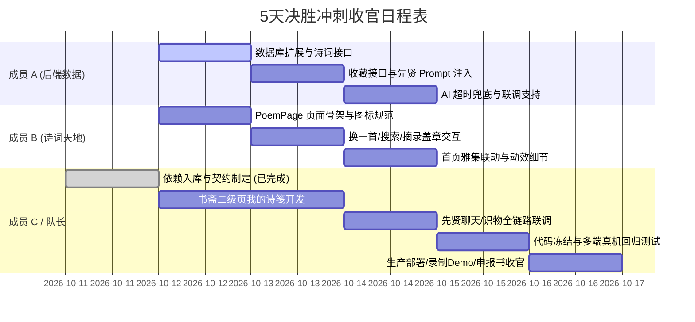

# 📜《云山竹简 · 华风雅集》第二阶段全栈技术需求文档 (TRD v2.0)
## 暨 5 天决胜收官冲刺任务分配书

| 文档版本 | 状态 | 编写人 | 适用范围 | 冲刺周期 |
| :--- | :--- | :--- | :--- | :--- |
| **v2.0.0 (决胜版)** | **已生效 (Approved)** | 队长兼技术架构师 (成员 C) | 全体研发团队 (成员 A、B、C) | 2026-10-12 ～ 2026-10-16 (共 5 天) |

---

## 一、 项目背景与第二阶段核心攻坚目标

### 1.1 决胜背景
本项目已圆满完成第一阶段（Phase 1）的前端视觉重构、移动端动态 rem 视口锁控与高保真主界面开发。  
**第二阶段（Phase 2）的核心使命是：在 5 天之内完成全栈深度打通，交付可进行全流程实机演示、评委现场互动的完整 Demo 系统**。

### 1.2 核心攻坚指标 (5天 Demo 验收基准)
1. **全栈数据闭环**：彻底告别静态假数据，用户注册登录、古诗词品读、一键摘录、先贤对话、文博识器全部形成数据库读写闭环。
2. **双 AI 实质落地**：
   - **DeepSeek LLM**：实现盛唐李白、东坡居士、阳明心学、易安居士四大先贤的针对性角色 Prompt 论道；
   - **Coze 多模态**：实现传世文博器物拍照智能识别，并沉淀入文人鉴宝名录。
3. **新增【古诗词天地】沉浸式模块**：基于两宋水墨卷轴排版，接入中国古籍诗泉 API，支持搜索、品读、AI 赏析与摘录。
4. **【队长特别禁令】严禁生硬图片图标，全量统一为 Ant Design Mobile 矢量图标体系**。

---

## 🚫 二、 队长核心设计规范红线：图标体系全面规范化

> ### ⚠️ 队长特别强调（全员必读执行）
> **代码中严禁随处截取、硬塞各种格式不一、底色不透、放大模糊的“生硬图片图标（png/jpg）”！严禁用原生粗糙字符 `>` 充当箭头！**  
> 队长已在主干安装好官方图标库 `antd-mobile-icons`，**所有人必须到 Ant Design Mobile 官方图标库寻找标准矢量图标组件！**

### 2.1 为什么必须禁用散装图片图标？
1. **无法自适应着色**：图片图标无法随 CSS `currentColor` 或 Less 变量 `@color-seal`（朱砂红）自动切换高光与激活态，极易产生色差脏乱。
2. **破坏国风克制美学**：生硬的外部剪贴画图片带有廉价贴纸感，严重破坏两宋宣纸的淡雅文人意境。
3. **加载与高清屏模糊**：PNG 缩放后边缘产生毛刺，而矢量 SVG 组件在 Retinal 视网膜屏下始终保证绝对锐利。

### 2.2 官方图标库引入与使用规范速查表

全员统一使用 `import { IconName } from 'antd-mobile-icons'`：

| 业务场景 | 严禁用 | 必须使用的 antd-mobile 官方矢量图标 | 代码调用示例 |
| :--- | :--- | :--- | :--- |
| **列表跳转 / 展开箭头** | `&gt;` 或图片箭头 | `<RightOutline />` | `import { RightOutline } from 'antd-mobile-icons'` |
| **搜索框检索** | 截图放大镜 | `<SearchOutline />` | `import { SearchOutline } from 'antd-mobile-icons'` |
| **诗词 / 墨卷收藏** | 散装五角星/红心图 | `<HeartOutline />` 或 `<StarOutline />` | `import { HeartOutline } from 'antd-mobile-icons'` |
| **诗卷品读 / 翻阅** | 书本图片 | `<BookOutline />` 或 `<FileOutline />` | `import { BookOutline } from 'antd-mobile-icons'` |
| **密码可见 / 隐藏** | 手写 SVG 拼接 | `<EyeOutline />` / `<EyeInvisibleOutline />` | `import { EyeOutline, EyeInvisibleOutline } from 'antd-mobile-icons'` |
| **重研墨宝 (换一首)** | 刷新截图 | `<RedoOutline />` 或 `<UndoOutline />` | `import { RedoOutline } from 'antd-mobile-icons'` |
| **安全 / 印章锁** | 外部小锁图 | `<LockOutline />` | `import { LockOutline } from 'antd-mobile-icons'` |
| **朗读 / 抚琴听音** | 喇叭切图 | `<SoundOutline />` | `import { SoundOutline } from 'antd-mobile-icons'` |

### 2.3 图标国风化着色准则
所有引入的 `antd-mobile-icons`，必须在对应 Less 中通过样式规则锁定中国传统色：
```less
// 统一朱砂红印泥色与尺寸基准
.shuzhai-arrow, .poem-action-icon {
  font-size: 16px;
  color: @color-seal; // #9E2A2B 朱砂红
  vertical-align: middle;
}
```

---

## 🏛️ 三、 第二阶段功能架构与模块需求明细

```
┌────────────────────────────────────────────────────────────────────────┐
│                        《云山竹简 · 华风雅集》第二阶段架构图                     │
├────────────────────┬────────────────────┬──────────────────────────────┤
│  1. 雅集 (首页)    │  2. 观藏 (殿堂)    │  3. 书斋 (修持)              │
├────────────────────┼────────────────────┼──────────────────────────────┤
│ • 每日诗签(真实接口)│ • 四大先贤横向画廊 │ • 水墨身份卡片               │
│ • 岁时物候干支     │ • 先贤论道(DeepSeek)│ • 修持四维数据 (真实持久化)  │
│ • 核心入口路由修正：│   - 动态 sageId    │   - 鉴宝 / 论道 / 诗签 / 阶位 │
│   - 飞花诗令 ->     │   - 诗仙/东坡人设  │ • 我的诗笺二级列表 (已摘录)  │
│     【古诗词天地】  │ • 抚琴听音         │ • 账号设置 / 优雅离席        │
├────────────────────┴────────────────────┴──────────────────────────────┤
│  4. 全新独立模块：【古诗词天地】 (/poem)                                 │
│ • 宣纸水墨卷轴排版 • 搜索查找 • 重研墨宝(随机换一首) • 一键“摘录入卷”盖章动效 │
├────────────────────────────────────────────────────────────────────────┤
│  5. 全新独立模块：【博古识器】 (/recognition)                           │
│ • 硬件级相机采集 • Coze 传世器物多模态识别 • 金石品鉴报告卡片            │
└────────────────────────────────────────────────────────────────────────┘
```

### 3.1 模块一：【古诗词天地】(`PoemPage.jsx` + `poem.less`)
* **定位**：承接首页“飞花诗令”入口，供雅士沉浸式品鉴千古诗词。
* **技术实现要点**：
  1. 挂载时自动请求 `GET /api/poem/random` 获取一首精选古诗词；
  2. 顶部集成 `antd-mobile` 的 `SearchBar` 与 `<SearchOutline />`，支持按作者、诗名检索（`GET /api/poem/search?q=...`）；
  3. 页面采用宣纸诗卷版式，正文对仗断句居中竖排或优雅横排，标注朝代与诗人朱砂印；
  4. 底部四大互动按钮：
     - **“重研墨宝”**（图标 `<RedoOutline />`）：换一首随机诗词；
     - **“摘录入卷”**（图标 `<HeartOutline />`）：点击触发朱砂印章下压光效，调取 `POST /api/poem/collect` 存入数据库，Toast 提示“已摘录入书斋”；
     - **“诗境赏析”**（图标 `<BookOutline />`）：折叠面板展开先贤品鉴赏析；
     - **“返回雅集”**：利用导航返回上一页。

### 3.2 模块二：【先贤论道】(`AiChat.jsx` + `deepseekController.js`)
* **定位**：与千古知己深度思想交流。
* **技术实现要点**：
  1. 读取路由状态 `sageId`（李白、苏轼、王阳明、李清照）；
  2. 后端接收 `sageId`，动态切换 System Prompt：
     - `libai`：盛唐狂客，好酒任侠，出口成诗；
     - `sushi`：东坡居士，豁达风趣，好谈山水美食与旷达人生；
     - `wangyangming`：心学宗师，知行合一，致良知；
     - `liqingzhao`：婉约词宗，典雅敏锐，词意幽微。
  3. 对话气泡重构为水墨宣纸色与青黛色，消除生硬的现代蓝底气泡。

### 3.3 模块三：【博古识器】(`Recognition.jsx` + `cozeController.js`)
* **定位**：移动端拍照智能识宝。
* **技术实现要点**：
  1. 相机拍照采集 Base64 图片，向 `/api/coze/recognition` 发送请求；
  2. 识别返回：文物名称、所处朝代、形制特征与工艺美学解读；
  3. 识别成功后，自动调接口使用户的“鉴宝藏器数”增加 1。

### 3.4 模块四：【墨隐书斋 · 成果闭环】(`MinePage.jsx` + `PoemCollection.jsx`)
* **定位**：展示文人毕生修持成果。
* **技术实现要点**：
  1. 顶部修持四维属性（12 鉴宝 | 36 论道 | 48 诗签 | 玖阶）直接读取数据库真实计数；
  2. 点击“我的诗笺”列表项，进入二级页面 `PoemCollection.jsx`，瀑布流展示用户之前在古诗词天地“摘录入卷”的全部诗词卡片。

---

## 👥 四、 团队任务分工矩阵 (Task Allocation Matrix)

| 责任人 | 负责领域 | 对应 Git 分支 | 核心任务明细与交付物 | 交付时间线 |
| :--- | :--- | :--- | :--- | :---: |
| **成员 A** | **后端服务端与数据中枢** | `feat/phase2-backend` | 1. 运行 MySQL 增量 SQL（`users` 字段扩展 + `user_poems` 收藏表）；<br>2. 编写 `poemController.js` 与 `poemRoutes.js`，代理诗泉 API 并增加内存防刷缓存；<br>3. 实现 `POST /api/poem/collect` 与 `GET /api/poem/my-list` 接口；<br>4. 在 `deepseekController.js` 中实装李白/苏轼/王阳明/李清照 4 大先贤动态 System Prompt；<br>5. 完善 Coze 识物接口超时 5s 兜底机制。 | **Day 1 ～ Day 2 交付** |
| **成员 B** | **前端首页与古诗词天地** | `feat/phase2-frontend-poem` | 1. 新建 `PoemPage.jsx` 与 `poem.less`，路由配置在 `/poem`；<br>2. 严格按规范使用 `antd-mobile-icons`（`SearchOutline`, `RedoOutline`, `HeartOutline`），严禁使用死图片；<br>3. 实现水墨诗卷展示、搜索、换一首、诗意折叠赏析、“摘录入卷”印章动画与收藏请求；<br>4. 联动首页：将“飞花诗令”卡片跳转路径修正为 `/poem`，首页“每日诗签”挂载请求真实接口。 | **Day 2 ～ Day 3 交付** |
| **成员 C**<br>(队长) | **书斋闭环、全端图标与架构把关** | `feat/phase2-integrate` | 1. 已完成 `antd-mobile-icons` 基座安装并推送；<br>2. 重构 `AiChat.jsx` 界面为水墨先贤气泡对话；<br>3. 开发书斋二级页“我的诗笺”（`PoemCollection.jsx`），展示已收藏列表；<br>4. 联调“博古识器”识别结果卡片与鉴宝数据递增；<br>5. 全局多端真机测试、打包构建优化与分支无冲突合并。 | **贯穿全程，Day 4 封包** |

---

## ⏱️ 五、 5 天冲刺每日里程碑与验收标准



### 每日红线指标：
* **Day 1（10-12 晚）**：MySQL 表就绪，全员 pull 最新 main，成员 A 后端接口可返回 JSON，成员 B 页面骨架成型。
* **Day 2（10-13 晚）**：古诗词天地能成功请求古诗，点击“摘录入卷”能够写入数据库。
* **Day 3（10-14 晚）**：与李白对话顺畅，相机识宝卡片生成，书斋“我的诗笺”能查看历史摘录。
* **Day 4（10-15 晚）**：**Code Freeze（代码全量冻结）**。断网与弱网兜底测试通过，`npm run build` 0 报错。
* **Day 5（10-16 晚）**：部署完毕，产出 3 分钟高清演示录屏、答辩 PPT 与《AI 使用与团队实质贡献报告》。

---

## 🔒 六、 协同守则与防坑纪律

1. **白名单原则**：成员 B 切勿随意改动已完成的 `AIPage.jsx` 与 `MinePage.jsx`；成员 A 切勿改动前端公共路由；
2. **图标绝对规范**：所有按钮图标、箭头图标**必须从 `antd-mobile-icons` 引入**，若发现使用生硬图片图标一律打回 PR 重构；
3. **接口契约至上**：严格对齐 [`docs/PHASE2_API_CONTRACT.md`](./PHASE2_API_CONTRACT.md)，私自篡改返回字段视为违规；
4. **交接文档必随**：每次合并 PR 必须附带更新 `docs/handovers/` 下的开发记录与 AI 使用填报表。
